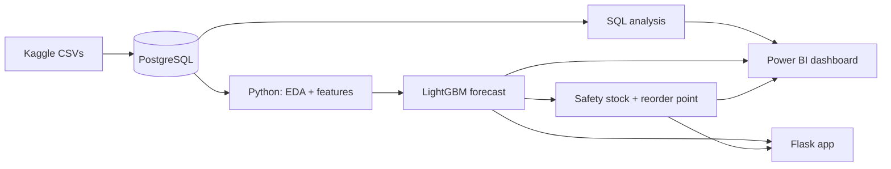
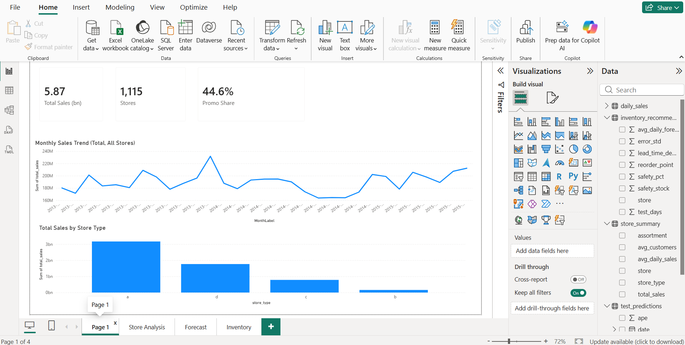
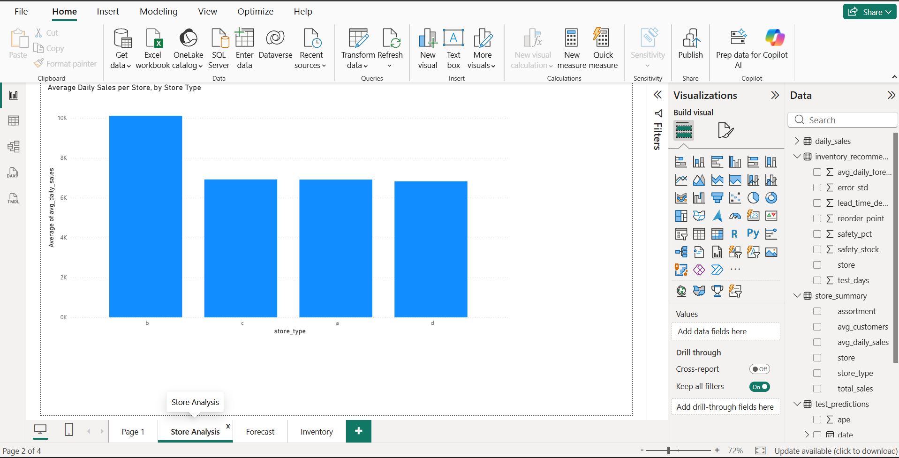
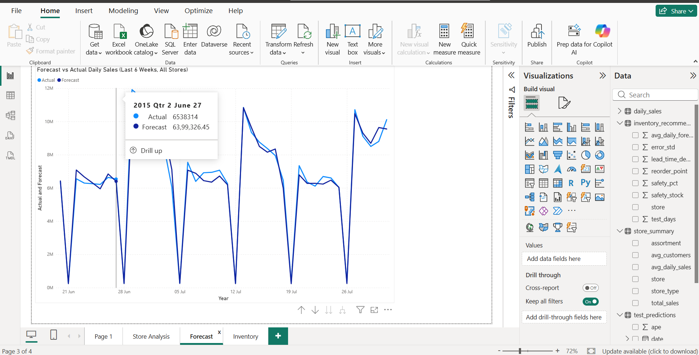
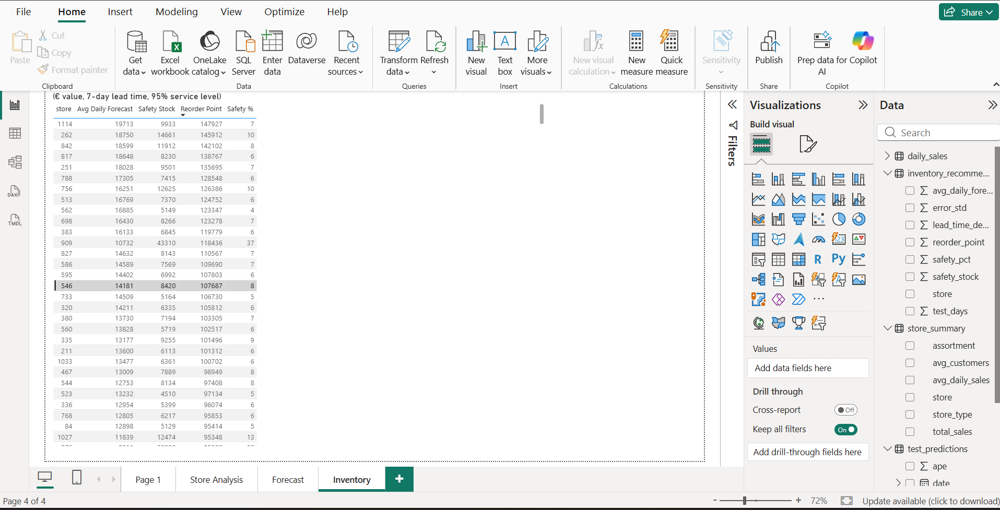
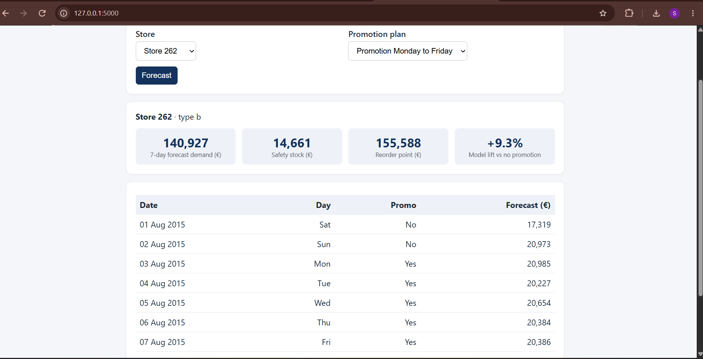

# Retail Demand Forecasting and Inventory Optimization (Rossmann)

An end-to-end analytics project on the Rossmann Store Sales data: SQL analysis in PostgreSQL, a LightGBM demand forecast, reorder-point recommendations for every store, a four-page Power BI dashboard, and a small Flask app that forecasts the next 7 days for any store.

**Result:** on a 6-week time-based holdout, the model cuts forecast error from **32.1% MAPE (naive "same weekday last week") to 10.0% MAPE** (MAE 2,189 to 673).

> All sales values are in euros (the dataset has sales value, not units). Reorder points are therefore stock levels in sales-value terms.

---

## 1. Problem

A retail chain needs to know how much each store will sell over the next week so it can decide **when to reorder and how much buffer stock to hold**. This project answers three questions:

1. What drives sales (promotions, holidays, store type, seasonality)?
2. Can we forecast daily store sales better than a simple last-week rule?
3. Given the forecast and its error, what reorder point should each store use?

## 2. Data

- Source: [Rossmann Store Sales](https://www.kaggle.com/c/rossmann-store-sales) (Kaggle). The raw files are **not** included in this repo; download `train.csv` and `store.csv` from Kaggle.
- 1,017,209 store-days, 1,115 stores, 1 Jan 2013 to 31 Jul 2015.
- Closed days (172,817 rows, sales = 0) were removed. **844,338 open store-days** are used for analysis and modelling (`train_clean`).

## 3. Architecture



## 4. Project structure

```
rossmann-forecasting/
├── 01_eda.ipynb    # EDA, features, model, inventory (run from this folder)
├── sql/            # setup script + analysis queries
├── app/            # Flask app, trained model and small input files
├── dashboard/      # rossmann_dashboard.pbix
├── data/           # small derived CSVs used by Power BI (raw Kaggle files excluded)
└── images/         # charts and screenshots
```

## 5. SQL analysis (PostgreSQL)

The queries in `sql/` use JOINs, CTEs, window functions (`LAG`, `RANK`), `CASE`, and `PERCENTILE_CONT`.

| Question | Finding |
|---|---|
| Promo vs no promo (all store-days) | Average daily sales 8,229 vs 5,930 (about +39%) |
| Promo effect per store (each store compared with itself) | Average uplift 41.4%, median 40.6% |
| Store type, per-store daily sales | Type b highest (10,233) vs about 6,800 to 6,900 for a, c, d |
| Store type, total sales | Type a contributes the most total sales (about 3.17bn of 5.87bn) because it has 602 stores |
| Sales per customer | Type d 11.25, a 8.71, c 8.50, b 5.06. Type b wins on traffic (about 2,022 customers/day), type d on spend per customer |
| Holidays (open stores only) | Easter 9,888 and Christmas 9,744 vs 6,954 on normal days |
| Competition distance | Stores with a competitor under 1 km average 7,311 vs 6,791 for over 5 km (busy locations attract both) |
| Weekdays | Monday strongest (8,216), Saturday weakest (5,875) |
| Sundays | Only **33 of 1,115 stores** open on Sundays, so Sunday averages are not comparable |

## 6. Data quality findings

- **181 stores (16%) are absent from the data for Jul to Dec 2014**, concentrated in store type d (23% of type d stores). Total sales dip in that period, but sales per open store-day stayed stable (about 6,700 to 6,900), so the dip reflects missing stores, not weaker demand. The cause is not stated in the data.
- Dec 2013 is the sales peak (about 232M). Dec 2014 total is lower (202M), but per store-day it matches Dec 2013 (8,604 vs 8,613).

## 7. Forecasting model

- **Target:** daily sales per store (modelled as `log1p(sales)`).
- **Features (18):** store, day of week, promo, state and school holiday flags, store type, assortment, competition distance, promo2, year/month/day/week, sales lags at 7, 14, 21 and 28 days, and the 4-week rolling mean of those lags.
- **No leakage:** the `customers` column is not used (it is unknown at forecast time), and the shortest lag is 7 days.
- **Validation:** time-based split. Train until 19 Jun 2015, test on the last 6 weeks (20 Jun to 31 Jul 2015, 40,282 rows). Early stopping used the last 6 weeks of the training period, not the test set.

| Model | MAE | MAPE |
|---|---|---|
| Baseline: same weekday last week | 2,189 | 32.1% |
| **LightGBM** | **673** | **10.0%** |

Error is balanced across groups: MAPE by store type a 10.3%, b 8.2%, c 10.0%, d 9.8%; promo days 10.2% vs non-promo days 9.9%.

**Most informative features (share of gain):** 4-week rolling mean 58.3%, lag_14 15.1%, promo 10.7%, lag_28 4.9%, day of month 2.7%. This is feature importance, not proof of causation.

**Promotion what-if (model):** switching `promo` from 0 to 1 on the test days raises forecast sales by **30.6%** overall (type a 30.4%, b 21.1%, c 31.2%, d 31.6%). This is lower than the 40.6% from the SQL comparison; the SQL number compares different days and is best read as an upper bound.

## 8. Inventory optimization

For each store:

```
safety stock  = z x std(forecast error) x sqrt(lead time)
reorder point = lead-time demand + safety stock
```

Assumptions (not company data): **lead time 7 days, service level 95% (z = 1.645)**. Error standard deviation comes from the 6-week test window; stores with fewer than 20 test days are excluded. Output: `data/inventory_recommendations.csv`.

Example: store 262 needs a safety stock of about 14,661 and a reorder point of about 145,912 (euro value). Store 909 is an outlier (safety stock 43,310, 37% of its reorder point) because its forecast error is unusually high; the cause was not investigated.

## 9. Power BI dashboard

`dashboard/rossmann_dashboard.pbix` has four pages: Overview (KPIs and monthly trend), Store Analysis, Forecast vs Actual, and Inventory (reorder table).

| Overview | Store Analysis |
|---|---|
|  |  |

| Forecast vs Actual | Inventory |
|---|---|
|  |  |

## 10. Flask app

Select a store and a promotion plan (none, Monday to Friday, or all days). The app forecasts the next 7 days (1 to 7 Aug 2015), shows the safety stock and reorder point, and reports the model-estimated lift versus no promotion. Stores that do not open on Sundays are shown as closed.



## 11. How to run

1. Install PostgreSQL, create a database named `rossmann`, run `sql/00_setup.sql`, and import `train.csv` and `store.csv` from Kaggle into the `train` and `store` tables (pgAdmin: Import/Export Data, header on). Then run the `train_clean` statement at the end of `00_setup.sql`.
2. `pip install pandas matplotlib seaborn sqlalchemy psycopg2-binary lightgbm scikit-learn scipy jupyter flask`
3. Run `01_eda.ipynb` top to bottom (open it from the project root so the `data/`, `images/` and `app/` paths resolve). The first cell asks for your PostgreSQL password; it is not stored in the notebook.
4. Start the app: `cd app` then `python app.py`, and open http://127.0.0.1:5000

## 12. Limitations

- The test window is a single 6-week period (Jun to Jul 2015); it does not include the Christmas peak. No cross-validation or hyperparameter tuning was done.
- Promotions and holidays are assumed to be known in advance. The app assumes no state or school holidays.
- The model is trained on open days only, so it assumes the store is open (Sunday closures are handled by a rule in the app).
- Safety stock uses 36 to 42 test days per store, so it is noisy. The `sqrt(lead time)` formula assumes independent daily errors, and lead time and service level are assumptions.
- Monday peaks are slightly under-predicted in the aggregate forecast chart.
- Promo lifts are model estimates, not proven causal effects. The SQL comparisons are correlational.
- Values are euros, not units, so reorder points are in value terms.
- Not investigated: why store 909 has a very large forecast error, why type b shows a smaller promo lift (21%), and why 181 stores are missing in Jul to Dec 2014.

## 13. Next steps

Compare against Prophet and XGBoost, add time-series cross-validation, recursive multi-week forecasting, and estimate safety stock on a separate validation window.

## Author

Sabithra S | [GitHub](https://github.com/Sabithra12) | [LinkedIn](https://www.linkedin.com/in/sabithra-s-296409294)
